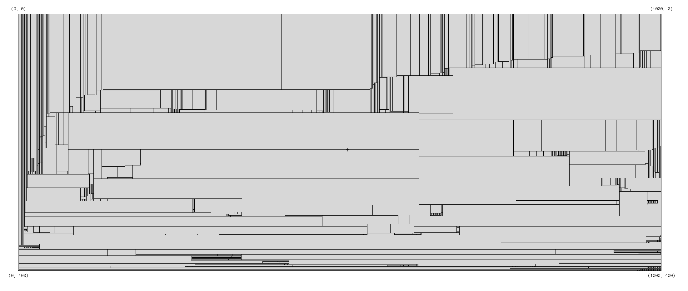
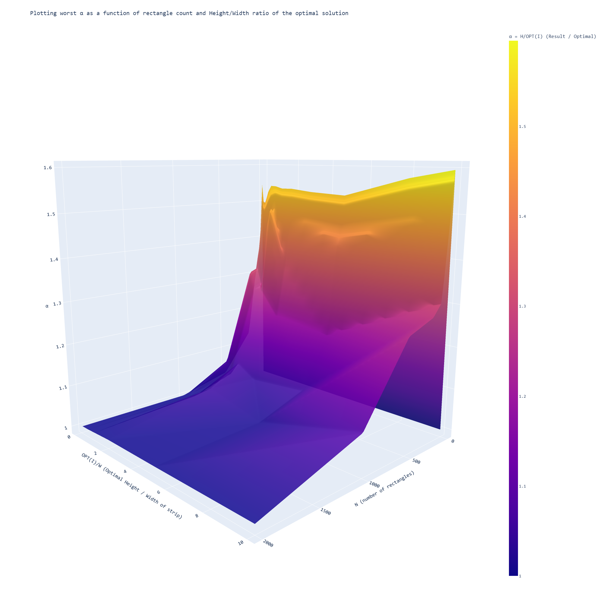
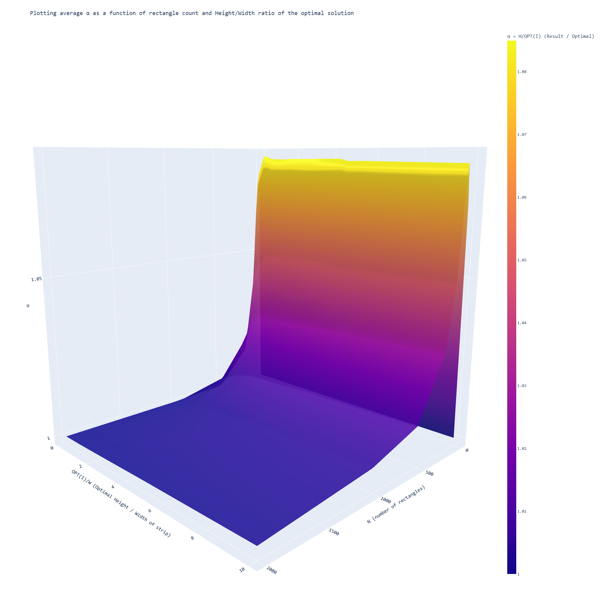
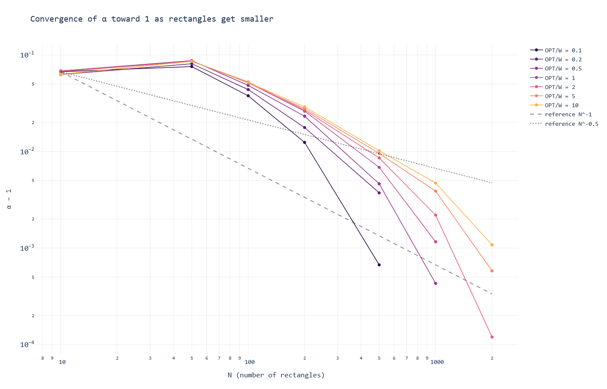
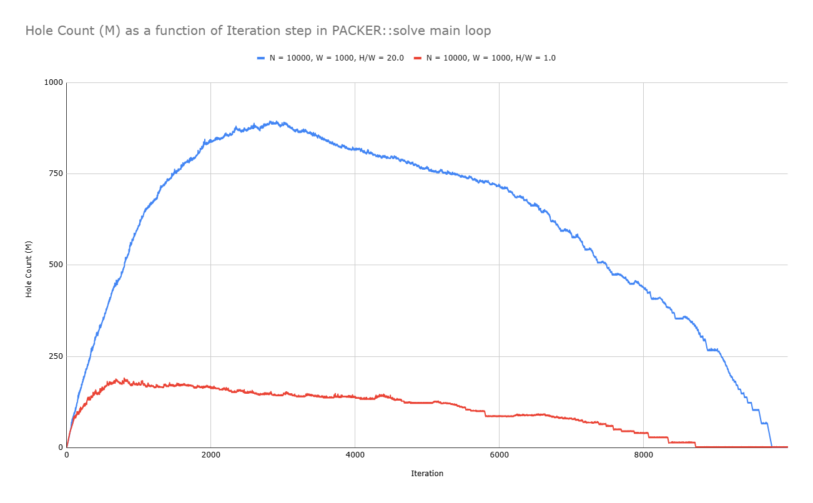

# Strip Packing

C++ solver for the NP-hard [strip packing problem](https://en.wikipedia.org/wiki/Strip_packing_problem): fit `N` rectangles into a strip of fixed width `W` without overlap, using as little height as possible.

We keep track of empty space as we place the rectangles instead of tracking the rectangles themselves. The strip starts as a single *"hole"* of size `(W, ∞)`. Placing a rectangle splits whatever hole it landed in into multiple other holes and overlaps with neighbouring holes get fixed.

## Example (visualizer.cpp)



## Build

```bash
git clone https://github.com/R-Besson/strip-packing-cpp-rewritten.git
cd strip-packing-cpp-rewritten

make            # optimized (default)
# make debug
# make release  # static

cd build
# run any executable with no args for usage. enjoy! :)
```

For the SFML visualizer: [Linux](https://www.sfml-dev.org/tutorials/3.0/getting-started/linux/), [macOS](https://www.sfml-dev.org/tutorials/3.0/getting-started/macos/). Windows users install [MSYS2](https://www.msys2.org/), then `pacman -Ss SFML` and `pacman -S <package>` in the MSYS2 terminal.

## Input File Format

```
<rect 1 width> <rect 1 height>
<rect 2 width> <rect 2 height>
...
```

## Instances & Benchmarks

`generate` builds an instance `I` such that we know `OPT(I)`. Given a width `W` and a height ratio `r (H/W)`.. it takes the rectangle `(W, W·r)` and recursively splits it until you have `N` pieces. Since nothing is lost when splitting, the areas sum to `W·H` and the area lower bound `⌈area/W⌉` equals `H`. So `OPT(I) = H`.

You can also use the standard sets from [2DPackLib](https://site.unibo.it/operations-research/en/research/2dpacklib) or [OR-Datasets](https://github.com/Oscar-Oliveira/OR-Datasets).

`bench` can run multiple random instance generations, solves, and saves into a .csv file.

## Results

`α = H / OPT(I)` is how "optimal" the solution the solver achieved. We use `N` from 10 to 2000 and `OPT/W` from 0.1 to 10. We can then extrapolate. The raw data is in [./runs/](./runs/).

### Worst case



The peak (our worst of the worst result) sits above 1.5, at small `N` and short strips. No polynomial algorithm gets an absolute ratio below 3/2 unless P=NP, by reduction from PARTITION, and the best ratio anyone has proven so far is 5/3+ε.

### Average case



Average `α` stays under 1.1 everywhere, and most of the surface is below 1.02. The high `α` values are again confined to small `N`. once there are a few hundred rectangles the packing is within a couple of percent of optimal regardless of `r`.

### Convergence



With `N` on a log axis and one curve per `r`, we observe that `α − 1` falls from about 8% at `N = 10` to between 10⁻³ and 10⁻⁴ at `N = 2000`, and the curves steepen as they go, so the decay is faster than `1/N`.

This is where the excess height should be governed by the tallest rectangle. Kenyon and Rémila's AFPTAS bounds the height by `(1+ε)·OPT + O(1/ε²)·h_max`, so the additive term shrinks as pieces get smaller relative to the strip, which is exactly what raising `N` at fixed geometry does.

The curves are also cleanly ordered by `r`, and stay ordered across the whole range: taller strips give a slightly larger `α − 1`, and the gap widens with `N`.

## Complexity

`O(N·M²)` time and `O(M)` space, where `M` is the number of holes held. Measured across the benchmark runs, `M = Θ(N)`, which gives **`O(N³)` time, `O(N)` space**.


Initial sort of rectangles is `O(N log N)`. Followed by the main `N` iterations consistting of :

| | |
| --- | --- |
| `getBestHole` | `O(M)` |
| `fewNeighborsOnLeft` | `O(N)` |
| `updateHoles` | `O(M²)` |



## References

- Kenyon & Rémila (2000), *A near-optimal solution to a two-dimensional cutting stock problem*
- Burke, Kendall & Whitwell (2004), *A new placement heuristic for the orthogonal stock-cutting problem*
- Iori, Martello, Monaci et al., *2DPackLib*